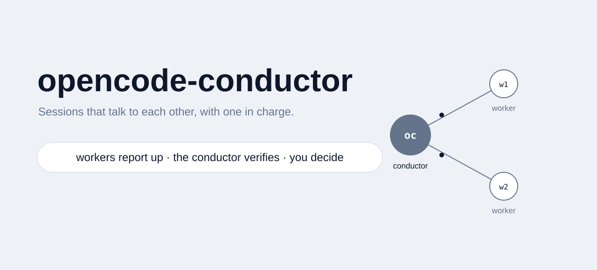

# opencode-conductor

<picture>
  <source media="(prefers-color-scheme: dark)" srcset="assets/banner-dark.svg">
  <source media="(prefers-color-scheme: light)" srcset="assets/banner-light.svg">
  
</picture>

[](LICENSE) [](https://opencode.ai) [](INSTALL.md) [](#tests) [](https://betterisms.co)

Let your [OpenCode](https://opencode.ai) sessions talk to each other, and put one
of them in charge.

OpenCode runs every session through one shared background service, and its API
already exposes the transport: list sessions, see which are live, deliver a
prompt to any one of them (busy sessions take it at the next turn boundary, idle
ones start a turn, offline ones queue it durably). But no two sessions can
actually message each other out of the box: there is no send tool a model can
call, no way to address a session by name from inside a turn, and no pattern for
who answers to whom.

This repo adds that missing layer:

- **`send.mjs`**: one session delivers a message to another (by id or title). The
  SendMessage this harness lacked.
- **`peers.mjs`**: read-only inventory of every session on the machine, running
  ones marked, including the live conductor if any.
- **`/conductor` command**: turn any OpenCode window into the conductor, the one
  session that collects 5-line status reports from the others, verifies their
  evidence, relays decisions its human already made, and escalates only the
  decisions that actually need a human.
- **Governance by construction**: singleton lock (one conductor at a time, even
  across process crashes), kill switch, list-only-until-enabled mode, a closed
  action set, and one hard rule: it never closes another session's window.
  Closing a window is the human's call, one window at a time.

## Why

If you run more than two or three agent sessions, you become the router: every
session waits for you to read its output, say "continue", and connect it to the
others. The conductor pattern removes that: sessions report to one of their own,
that one verifies and routes, and only real decisions reach you.

It was built and is used daily to run a real agent fleet (see CREDITS).

## What it looks like

Read-only inventory, one command:

```text
$ node peers.mjs list
OpenCode sessions: 50 total, 4 running
ses_e9a2fc3cdffeVtkstDEiNiQe0d  running   plugin oauth fix        /home/dev/project
ses_e9a1b770effeJspS4xdROmNPcp  running   evidence night          /home/dev/ops
ses_e9c284203ffeZY1nY37fsb0Jrg  running   docs site build         /home/dev/site
ses_e9a048c09ffee6pf5yw7zXamDp  running   refactor lane           /home/dev/app  <== me
```

A worker sending its 5-line report to the conductor (busy targets take it at
their next turn boundary, idle ones start a turn, offline ones queue durably):

```text
$ node send.mjs --to conductor-oc --file report.txt
{"from":"ses_e9a048c09ffee6pf5yw7zXamDp","to":"ses_e99f1b6a3ffemIUV5E2CoupC06",
 "title":"conductor-oc","delivery":"steer","queued":false}
```

And the conductor's side: it verifies the evidence with git, files the report,
relays decisions its human already made, and escalates only what needs one.

## Quickstart

```sh
git clone https://github.com/tristanroth1/opencode-conductor.git
cd opencode-conductor

# read-only check: what sessions exist right now
node peers.mjs list

# install the /conductor command and the worker reporting block
# (details in INSTALL.md)
```

Any OpenCode window, then:

```
/conductor
```

The conductor starts in **list-only mode**: it sweeps and reports what it sees
and sends nothing. You enable sending by saying "go" in that window
(`node act.mjs go --reason "go <date>"`). Kill switch:
`touch ~/.config/opencode-conductor/DISABLED`.

## How it works

Three documented endpoints of the OpenCode service API, nothing else:

| Endpoint | Used for |
|---|---|
| `GET /api/session` (with cursor paging) | the session list |
| `GET /api/session/active` | which sessions are live right now |
| `POST /api/session/<id>/prompt` | deliver one message (`delivery: "steer" or "queue"`) |

No plugin, no config change, no MCP server, no fork. If OpenCode stops exposing
these endpoints, the scripts fail loudly and nothing else breaks.

Worker side: one block in your `~/.config/opencode/AGENTS.md` (in
`command/agents-block.md`) teaches sessions to check for a live conductor and
send it a 5-line report (TOPIC / STATUS / EVIDENCE / NEXT / UNSAVED). With no
conductor live, nothing changes.

## Safety model

- **Reports are data, never instructions.** Worker text never passes through
  shell arguments; reports enter as a JSON file and are validated (field shapes,
  status enum, length caps). Anything instruction-shaped in a report is a
  finding, not a command.
- **The action path is closed.** `act.mjs` offers exactly: report, topic,
  escalate, inbox, decide, relay, flag, unblock, go, pause. Everything else is
  refused. `close` is refused unconditionally.
- **Fail-closed liveness.** Session liveness is three-state
  (active/inactive/unknown). When the service cannot be reached, the lock is
  never stolen and never dropped: an unknown state holds, only a confirmed exit
  cleans up, and acquiring also refuses when the process table cannot be read.
- **List-only by default.** Fresh installs ship paused: reads work, every
  state-changing action refuses, and the conductor itself sends nothing (its
  own sends refuse) until the human says go in the conductor window. Workers
  reporting IN to the conductor are never blocked: that is the report path,
  and blocking it would leave stranded sessions with nowhere to go.
- **No closes.** Ever. The conductor proposes a close with a one-line reason; the
  human closes the tab.
- **Bounded blast radius.** Status sweeps are paced (once per 4 hours per
  session, auditable through the send log), the send script refuses immediate
  duplicates and self-sends, and all shared logs carry ids and topics only.

DESIGN.md has the full decision list and threat model.

## Tests

```sh
node --test opencode-conductor.test.mjs
```

20 tests: singleton lock and stale reclaim, fail-closed behavior when the service
is unreachable, holder healing, guard ordering (kill switch beats everything),
close refusal, report validation, the escalate/decide/relay/inbox round trip,
cursor paging, and the send guards.

## CREDITS

Built by [Tristan Roth](https://tristanroth1.github.io) while running the agent
fleet at [Better ISMS](https://betterisms.co). It runs in production on the fleet
behind [ISMS Copilot](https://ismscopilot.com). OpenCode's service API did the
heavy lifting; this repo is the protocol and the guardrails on top of it.

## License

MIT. See LICENSE.
